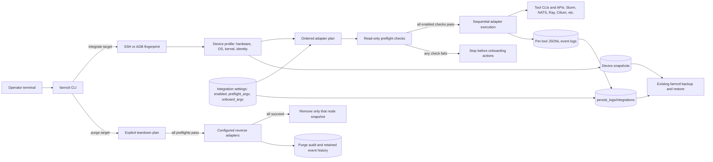

# farmctl

Device fleet scanning, taxonomy-based archiving, and cloud backup/restore
for a self-hosted compute farm — SSH-reachable Linux nodes and ADB-reachable
Android nodes alike.

This is a **private, domain-specific consumer project**, not a core logic
package. It requires both [`autopath`](https://github.com/NRAEnterprises/autopath-package)
and [`cloud-restore`](https://github.com/NRAEnterprises/cloud-restore-package) as real,
separately-installed prerequisites — it consumes and configures them, it
does not vendor a copy of either or shape how either one works. Neither
core package knows `farmctl` exists.

## Install

```sh
curl -LsSf https://raw.githubusercontent.com/NRAEnterprises/farmctl-package/main/install.sh | sh
```

This installs `autopath` and `cloud-restore` first, as explicit prerequisite
steps, then `farmctl` itself. All three are pure Python stdlib — nothing
here needs compiling, on Linux or Termux.

## Quick start

```sh
farmctl configure                        # backend, remote, project name — once
farmctl integrations                     # detect tools and save active defaults
farmctl scan node-1.local --type ssh
farmctl scan emulator-5554 --type adb
farmctl backup
```

## Cluster integration inventory

`farmctl integration` tracks desired integration switches, non-secret
configuration snapshots, and append-only operational events for Slurm,
NATS JetStream, Ray, Cilium, Ansible, Nomad, NetBox, Kubernetes, Falco,
KEDA, Argo CD, Tetragon, Tailscale, Temporal, Loki, Tempo, DeepSpeed,
IPEX-LLM, Terraform, Kafka, ZeroMQ, RabbitMQ, Redpanda, Redis Streams,
Rubix, Apollo, Falcon, VictoriaMetrics, GraphQL, SQL, DuckDB, NubeIO,
MQTT, Modbus, NGINX, ngrok, BACnet, Grafana, BOINC, regex, rsync, rclone,
Prometheus, Hetzner, Equinix Metal, OVH, IXP, ARIN, RIPE, TrueNAS,
Cloudflare, WireGuard, and Son of Grid Engine. It records intent and
observations locally; it does not install or configure the services by
itself. Records are stored beneath the same
`persist_logs/integrations/` tree as device snapshots and are included in
the existing backup/restore flow.

Run `farmctl integrations` to open the keyboard-driven tool selector. It
checks for known command-line clients/modules on the farmctl host, dims
unavailable entries, and lets you move with the arrow keys and toggle
available tools with Space. Press Enter to save persistent active/inactive
defaults; press `q` or Escape to cancel. An unavailable tool is saved as
inactive and therefore skipped instead of treated as an expected adapter.
Detection means only that a local client/module is installed—it does not
prove that a remote service is reachable or authenticated. API integrations
may be detected through a generic client such as `curl`.

`farmctl integrate TARGET --type ssh|adb` uses the saved active set by
default. `--enable-component NAME` and `--skip-component NAME` are
repeatable, temporary overrides for one run and do not modify the saved
selection. The target and connection type remain necessary to identify the
node; the saved list supplies the normal tool selection.

### Architecture



The adapters execute on the machine running `farmctl`, in catalog order,
using that user's CLI installation and environment. SSH adapter commands
may then invoke a remote command on the target. Preflights run before any
onboarding command. Once onboarding starts, actions are sequential and are
not transactional: if a later tool fails, earlier tools may already have
changed state.

```sh
farmctl integration set slurm --enable \
  --switches-json '{"accounting":true,"gpu_gres":true}' \
  --config-json '{"cluster":"compute-a","partition":"gpu"}'
farmctl integration set nats-jetstream --enable \
  --switches-json '{"file_storage":true,"replicas":3}'
farmctl integration show
farmctl integration log slurm job.submitted \
  --data-json '{"job_id":"4821","node":"worker-02","state":"PENDING"}'
farmctl integration events slurm --limit 20
```

Settings are stored per component in `settings.json`; events are JSON Lines
in `events.jsonl`, each timestamped in UTC. These are deliberately generic
records so each cluster can capture its own scheduler, broker, policy,
autoscaler, and orchestration settings without requiring the services to
be installed on the farmctl host. Never include passwords, tokens, private
keys, or other secrets in `--config-json` or `--data-json`.

Device fingerprints now also expose normalized `manufacturer`, `model`,
`device_type`, and `architecture` fields alongside `kernel_release` and
`kernel_arch`; original platform probe values remain available in
`raw_probes` for backwards compatibility.

### Concrete adapters: Slurm, NATS JetStream, Ray, Cilium

Copyable argv-array examples are in `examples/integrations/`. Enable and
configure each adapter with the matching JSON file:

```sh
farmctl integration set slurm --enable --config-json "$(cat examples/integrations/slurm.json)"
farmctl integration set nats-jetstream --enable --config-json "$(cat examples/integrations/nats-jetstream.json)"
farmctl integration set ray --enable --config-json "$(cat examples/integrations/ray.json)"
farmctl integration set cilium --enable --config-json "$(cat examples/integrations/cilium.json)"
```

The Slurm example uses `scontrol create ... State=FUTURE` with the node's
observed CPU thread and memory values. This is specifically for Slurm's
dynamic/FUTURE node model and needs administrator authorization; a static
cluster normally needs its `slurm.conf` updated across the cluster and then
reconfigured. Do not use the dynamic example blindly on a static cluster.
See the [Slurm `scontrol` reference](https://slurm.schedmd.com/scontrol.html)
and [`slurm.conf` reference](https://slurm.schedmd.com/slurm.conf.html).

The NATS example assumes a JetStream KV bucket named `FARM_NODES` already
exists and the active NATS CLI context points at the intended server. Its
preflight runs `nats kv status FARM_NODES`; onboarding writes one
`node-<device_id>` record with compact hardware/kernel metadata. Create the
bucket separately with `nats kv add FARM_NODES` when appropriate, and verify
that the credentials permit writes—the read-only status probe cannot prove a
write ACL. See the [NATS KV tutorial](https://docs.nats.io/learn/key-value/your-first-bucket).

The Ray example checks the configured head address with `ray status`, then
uses SSH to run `ray start --address=...` on the worker. Replace
`RAY_HEAD_ADDRESS:6379` in both argv arrays and verify the worker has a
compatible Ray installation, access to the head, and the required ports.
See [Ray's on-premises cluster guide](https://docs.ray.io/en/latest/cluster/vms/user-guides/launching-clusters/on-premises.html)
and [Ray Core CLI reference](https://docs.ray.io/en/latest/ray-core/api/cli.html).

Cilium does not expose a general-purpose command to enroll a bare node into
a Cilium cluster. Kubernetes node registration and the Cilium agent DaemonSet
handle that lifecycle. The example therefore checks `cilium status --wait`
and adds a farmctl tracking label through `kubectl`; that label is not a
substitute for joining Kubernetes or deploying the Cilium agent. See the
[Cilium CLI cheat sheet](https://docs.cilium.io/en/stable/cheatsheet/).

### More adapter examples: Argo CD, Tetragon, Temporal, Loki

These configurations are in `examples/integrations/` and can be enabled in
the same way as the Slurm/Ray examples:

```sh
farmctl integration set argocd --enable --config-json "$(cat examples/integrations/argocd.json)"
farmctl integration set tetragon --enable --config-json "$(cat examples/integrations/tetragon.json)"
farmctl integration set temporal --enable --config-json "$(cat examples/integrations/temporal.json)"
farmctl integration set loki --enable --config-json "$(cat examples/integrations/loki.json)"
```

The Argo CD example reads and then syncs a pre-created `farmctl-node-bootstrap`
Application, attaching the node name as sync metadata. It assumes that
Application is deliberately designed to apply the desired bootstrap state;
syncing an Argo CD Application can change cluster resources. Review its
manifests and sync/prune policy first. See the [Argo CD `app get` reference](https://argo-cd.readthedocs.io/en/stable/user-guide/commands/argocd_app_get/)
and [`app sync` reference](https://argo-cd.readthedocs.io/en/latest/user-guide/commands/argocd_app_sync/).

Tetragon's example checks that its Kubernetes DaemonSet exists and adds a
farmctl tracking label to the node. The label itself does not install or
configure Tetragon. Once Kubernetes admits the node, the Tetragon DaemonSet
is responsible for scheduling its agent there; the [Tetragon Kubernetes guide](https://tetragon.io/docs/installation/kubernetes/)
documents its Helm deployment and rollout check.

Temporal is a service, not a node-enrollment registry. Its example verifies
frontend health at `TEMPORAL_FRONTEND:7233`, then starts a preinstalled
`temporal-worker` systemd unit on the node over SSH. That unit must already
contain the correct Temporal address, namespace, task queue, worker binary,
and credentials. The CLI health command is documented in [Temporal's troubleshooting guide](https://docs.temporal.io/troubleshooting/deadline-exceeded-error).

The Loki example checks `/ready` and sends one node-inventory event to
`/loki/api/v1/push` using the `{loki_push_json}` placeholder. Replace
`LOKI_HOST:3100`; if Loki is behind an authenticating proxy, configure curl
credentials securely outside this JSON file. This writes a log entry but
does not install a log collector or configure ongoing node log shipping.
See the [Loki HTTP API](https://grafana.com/docs/loki/latest/reference/loki-http-api/).

### One-command node onboarding

`farmctl integrate <target> --type ssh|adb` fingerprints a node once and
builds an ordered plan across the tracked integration catalog. It is plan-only by default.
After reviewing the plan, `--apply` archives the device snapshot, invokes
each enabled tool's configured adapter sequentially, and appends a per-tool
onboarding result. Each adapter is an argv array (`onboard_argv`) in that
component's config; farmctl invokes it directly without shell expansion.
Adapter commands inherit the current user's environment and credentials,
so normal CLI contexts such as `KUBECONFIG` continue to work.

```sh
# Configure an adapter once; use the node's existing Kubernetes context.
farmctl integration set kubernetes --enable \
  --config-json '{"preflight_argv":["kubectl","get","node","{hostname}","-o","name"],"onboard_argv":["kubectl","label","node","{hostname}","farmctl.io/managed=true","--overwrite"]}'

# Fingerprint and review every configured action; this makes no changes.
farmctl integrate worker-02 --type ssh

# Explicitly apply the plan. Each adapter is run in sequence.
farmctl integrate worker-02 --type ssh --apply
```

Available adapter placeholders: `{hostname}`, `{device_id}`,
`{manufacturer}`, `{model}`, `{device_type}`, `{architecture}`,
`{kernel_release}`, `{cpu_threads}`, `{memory_mb}`, and `{inventory_json}`.
`{inventory_json}` is a compact JSON object and `{loki_push_json}` is a
complete Loki JSON-push body, each suitable as one CLI argument.
Each enabled adapter must define both `preflight_argv` and `onboard_argv`.
`farmctl integrate --apply` runs every preflight first and aborts before any
onboarding command if one check fails or is missing. The checks are
configured by the operator and should be read-only; farmctl cannot prove
that an arbitrary user-supplied preflight command has no side effects.

For an explicit preflight-then-apply wrapper, use:

```sh
scripts/integrate-with-preflight.sh worker-02 --type ssh
```

The wrapper runs `farmctl validate-adapters` first and starts
`farmctl integrate --apply` only if all enabled adapter checks pass. Apply
repeats the checks immediately before mutations. Tools beyond the four
examples have catalog entries but need environment-specific `preflight_argv`
and `onboard_argv` configuration. A tool that is disabled, enabled without
an adapter, or missing its executable is reported rather than treated as
integrated. The adapters are user-configured commands because each tool
has distinct APIs, credentials, and cluster semantics; farmctl does not
invent safe Slurm/NATS/Ray/etc. mutations or claim to apply them without
an adapter. Review configured commands and target context carefully before
using `--apply`, especially for commands that alter production clusters.

### Validate only selected infrastructure tools

For a validation-only check of Tailscale, Kubernetes, and Prometheus, enable
each integration with a read-only `preflight_argv`. The supplied files are
validation profiles only; they do not configure an `onboard_argv` and are
not sufficient for `integrate --apply`:

```sh
farmctl integration set tailscale --enable --config-json "$(cat examples/integrations/tailscale-preflight.json)"
farmctl integration set kubernetes --enable --config-json "$(cat examples/integrations/kubernetes-preflight.json)"
farmctl integration set prometheus --enable --config-json "$(cat examples/integrations/prometheus-preflight.json)"

scripts/validate-adapters.sh worker-02 --type ssh \
  --component tailscale \
  --component kubernetes \
  --component prometheus
```

The selected components must be enabled and have preflight commands. The
checks run in the farmctl process environment: Tailscale checks the local
Tailscale daemon, `kubectl` uses the current kubeconfig/context, and Prometheus
uses the URL in its JSON file. Change placeholder host URLs to match your
services. This command fingerprints `worker-02` over SSH, runs only these
three configured probes, and never runs their onboarding actions.

### Troubleshooting adapter preflight failures

Start with the filtered validation command. It reports status and exit code
but intentionally suppresses stdout/stderr, since a CLI error may contain
tokens, endpoints, or other sensitive details:

```sh
farmctl validate-adapters worker-02 --type ssh \
  --component tailscale --component kubernetes --component prometheus
```

- **`not_configured`** means a requested component is missing or disabled.
  Set it with `farmctl integration set <component> --enable --config-json ...`.
- **`preflight_missing`** means it is enabled but has no `preflight_argv`.
  Add a read-only command array that returns exit code 0 only when the
  intended service endpoint and required CLI context are usable.
- **`preflight_executable_not_found`** means the first argv item is not on
  the farmctl host's `PATH`. Install the relevant CLI or correct its path.
- **`failed` with a nonzero return code** means the command ran but its
  check failed. Inspect its exact argv in `farmctl integration show`, then
  run that command manually as the same user to see the service's diagnostic.
  Check CLI context, credentials, DNS, firewall rules, endpoint URL, and
  role/ACL permissions. Do not paste secrets into the config JSON.
- **`timed_out`** usually indicates an unreachable endpoint, stalled auth
  helper, or too-short timeout. Check connectivity first, then increase the
  validation timeout with `--timeout SECONDS` if the service is simply slow.
- **`missing_profile_fields`** means the adapter requires a field such as
  CPU threads or memory that the node probe could not read. Verify SSH/ADB
  access and the remote OS utilities, then inspect the archived fingerprint.
- **`invalid_preflight` / `invalid_adapter`** means an argv array or
  placeholder is invalid. Only documented placeholders are expanded; shell
  syntax is not interpreted. Use JSON arrays and avoid embedding a shell
  script in one argument.
- **Apply-time failure after all preflights pass** means an action itself
  failed. Earlier adapters may already have succeeded. Inspect
  `farmctl integration events <component>`, verify the affected service's
  state, and retry only after reconciling partial changes.

For NATS, a read-only KV status check cannot guarantee the credentials can
write the inventory key. For Loki, `/ready` does not guarantee the proxy
permits the push request. These permission failures can only be confirmed
by a service-specific authorization probe or the actual write; the example
does not perform a write during preflight.

Later, after a rebuild:

```sh
farmctl restore
farmctl rebuild
```

### Disaster recovery and node teardown

`farmctl purge <target> --type ssh|adb` is plan-only by default. It finds
tools with a recorded onboarding attempt for that device ID and displays the
configured preflight and teardown commands. To apply, configure each such
tool with an explicit `preflight_argv` and `teardown_argv`, review the plan,
then repeat with `--apply --confirm-device-id <exact-id>` copied from the
plan. Every purge preflight runs before any teardown; a missing adapter or
failed preflight blocks all teardown actions. Farmctl does not invent resource
deletion commands for heterogeneous tools. If a teardown fails partway,
earlier external teardowns may have succeeded; farmctl retains the local
snapshot and writes the outcome to `persist_logs/integrations/purge_audit.jsonl`
for reconciliation. On complete success, only the selected node snapshot
directory is removed. Integration settings and event history are retained.
Back up first, and ensure each teardown reverses only resources created by
its matching onboarding adapter.

See the [comprehensive CLI reference](docs/cli-reference.md) for every
integration subcommand, flag, adapter field, and purge safety detail.

The `Adapter tests` GitHub Actions workflow runs the unit and mocked
integration suite on Python 3.10 and 3.12. It validates every shipped argv
example, expands placeholders against mock inventory, checks that dry-run
and preflight failures do not invoke onboarding actions, and exercises purge
confirmation, preflight, teardown, audit, and node-scoped deletion behavior.

## What each command does

### `farmctl configure`

Interactive, one-time setup: which backend (`rsync` or `rclone`), the
remote target, the project namespace, and whether to compress backups by
default (and with which algorithm/level). Saved to
`~/.config/farmctl/config.json`. Every other command reads this
automatically — nothing else needs these passed as flags.

### `farmctl scan <target> --type ssh|adb`

Fingerprints a device (OS, distro/Android version, kernel, root manager if
present) and archives it into a deep, automatic category tree — e.g. ten
identical units of the same model all converge under
a single `vendor/model-line/model/` folder, and you're prompted only for that specific
unit's file name within that folder. If the device can't be reached or
identified, nothing is archived and the command exits with an error —
earlier versions of this silently wrote a junk record for unreachable
hosts; that's fixed.

### `farmctl backup` / `farmctl restore`

Push/pull the entire local device archive via the backend configured in
`farmctl configure`. Compression (if enabled) and its algorithm are
handled automatically — `restore` reads the remote's own manifest to know
whether the data is compressed and how, so nothing about the compression
mode needs to be remembered or passed by hand, even if it changes between
backup runs.

```sh
farmctl backup --dry-run
farmctl backup --compress zstd --level 19    # override the configured default for this run
farmctl backup --no-compress                 # skip compression even if configured on
```

### `farmctl rebuild`

For after a full network wipe: reconnects every device on record (from
its last known SSH/ADB connection info), regenerates an appendable SSH
config, attempts to reconnect any network ADB targets, and writes a
`kubectl label node` script from the archived fingerprints — plus a
reachable-vs-missing report so you know what needs physical
re-onboarding versus what just needs a network to come back.

### `farmctl merge <source-dir> [<source-dir> ...]`

For restoring from multiple independent sources (e.g. two different
collectors that both backed up overlapping parts of the fleet):
re-derives each device's canonical identity from its own fingerprint data
(not from whichever folder name a source happened to use), de-duplicates
by actual content hash, and converges everything into the one canonical
local archive — without losing genuinely distinct history.

### `farmctl status`

Prints current config and a summary of the local archive (root path,
device count).

### `farmctl compressors`

Passthrough to `cloud-restore`'s compression availability check — see
what's actually installed on this machine.

## Where things live

- Device archive (auto-detected per platform):
  - Linux: `/home/Documents/persist_logs/`
  - Termux: `/data/data/com.termux/files/home/persist_logs/`

  Deliberately a fixed, non-per-user path — this is meant to work
  correctly even on a system running as root with no real user session,
  and to survive a rebuild regardless of which account runs the collector
  next time.
- `farmctl` config: `~/.config/farmctl/config.json` (genuinely per-user,
  unlike the archive above).

## Dependency structure, explicitly

```
autopath        <- standalone, zero dependencies
cloud-restore   <- standalone, zero dependencies (not even on autopath)
farmctl         <- requires BOTH of the above; contains only
                    device-fleet-specific logic (device_inventory.py)
```

If you're looking for reusable, project-agnostic path/backup logic for a
*different* project, use `autopath` and `cloud-restore` directly — this
package is the private consumer, not the thing to build on top of for
something unrelated to device fleet management.

## License

Private/internal (update this section before any public release —
`farmctl` contains domain-specific logic you may not want to publish even
if `autopath` and `cloud-restore` are released separately).
